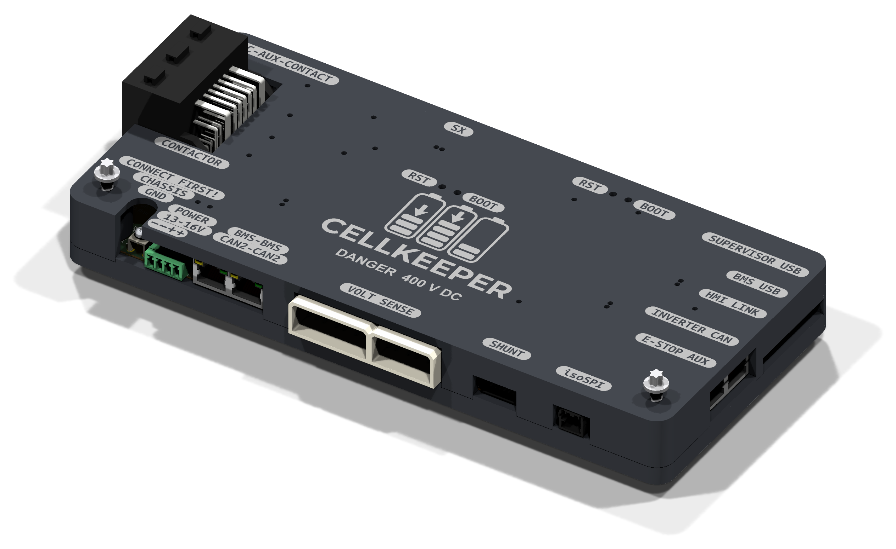

# CellKeeper BMS — v1.1

KiCad PCB design for the **CellKeeper Battery Management System**, a replacement BMS controller for battery packs using the isoSPI protocol. The main board fits the Tesla battery's penthouse: the pack's original harness, HV sense, shunt and BMB connectors plug into it, and it mounts on the original brackets.

Each ordered revision has a [release](https://github.com/cellkeeper-bms/cellkeeper-hardware/releases) with its Gerbers, JLCPCB BOM and CPL, schematic PDF, board PDF (3D views and 1:1 prints) and the enclosure print files. Rev 1.1 was ordered on 2026-10-28; work towards rev 1.2 is on the `rev1.2` branch.

## Overview

- **MCUs:** two Raspberry Pi RP2354B (dual Cortex-M33, 2 MB in-package flash): the main BMS controller and an independent supervisor, linked by UART. The supervisor also sees the isoSPI receive line and the E-stop input, and it alone enables the contactor drivers.
- **Current sensing:** TI INA228 (20-bit) on a galvanically isolated domain (ISO1540 I2C isolator, isolated 5 V DC-DC), also reading the shunt's temperature.
- **HV sensing:** 6 sense points (BAT±, LINK±, FC±) through 501:1 dividers into two ADS1115 ADCs: pack, link and output voltage, and the voltage across each contactor.
- **BMB communication:** transformer-isolated isoSPI master (SP3485 driver, AM26LV32 receiver, HM2113 transformer), Manchester-encoded by the RP2354's PIO.
- **CAN:** two ISO1050 interfaces: inverter CAN, isolated with its own DC-DC, on an RJ45 shared with the E-stop and aux lines; and inter-BMS CAN2 on a pass-through RJ45 pair (not isolated).
- **Contactors:** four low-side drivers (FC+, FC-, Link+, Link-): BSC0805LS MOSFETs and UCC27524 gate drivers, PWM'd by the firmware to economise the hold current. The contactor supply is sensed.
- **Supply:** 13–16 V logic and contactor inputs (separate, both sensed), TPS5430 5 V buck and 3.3 V LDO; chassis ground terminal.
- **HV battery:** 400 V nominal.
- **USB-C ×3:** BMS, supervisor, and HMI link. The HMI link is not for a computer: it powers an external ESP32 display (5 V 1 A) and carries its serial.
- **I/O:** E-stop input (optocoupler; jumper JP37 disables it), an extra opto input and two extra outputs, fast-charge contactor aux-contact inputs for weld detection, SX serial interface, and experimental PCS signals on jumpers.
- **Board revision** strap on GPIO47 (ADC7).

## Repository Contents

Three boards, each its own KiCad project. They share no copper: the hat and the precharge board
connect to the rest of the system by wires and lugs.

| Path | Description |
|------|-------------|
| `CellKeeper/` | Main controller board (`CellKeeper.kicad_pro`). Each ordered revision's Gerbers, BOM, CPL, schematic and board PDFs are on the [releases](https://github.com/cellkeeper-bms/cellkeeper-hardware/releases) page |
| `isoSPI-Hat/` | isoSPI hat for a Raspberry Pi Pico: SP3485 / AM26LV32 / HM2113 transformer to the BMB connector |
| `Precharge/` | Precharge board: six PTCs (three parallel strings of two) between M8 lugs, plus the HV system wiring diagram |
| `lib/` | Shared `CellKeeper_Local` symbol and footprint libraries and `CellKeeper.3dshapes` 3D models |
| `enclosure/` | 3D-printable case for the main board (build123d) |
| `graphics/` | Silkscreen artwork and README images |
| `python_scripts/` | README renders (`render_readme_images.py`), release files (`export_release_files.py`), 3D model generators |
| `docs/` | How to release a revision (`releasing.md`), README notes |

## Enclosure

A two-part printed case (base tray and lid) for the main board, generated by
`enclosure/cellkeeper_case.py`. It mounts in the penthouse on the original HVC brackets. The lid
carries the logo and connector labels, which can be printed as a contrasting-colour inlay, with
open tunnels over the LEDs. Ready-to-print STEP and STL files are attached to each
[release](https://github.com/cellkeeper-bms/cellkeeper-hardware/releases); running the script writes
them to `enclosure/output/print/`.
The board shows the case in KiCad's 3D viewer through the `ENC1` footprint.

## Safety

⚠️ This board interfaces with 400 V battery packs that can deliver **lethal** current. Only qualified personnel should work on high-voltage systems. This is a v1.1 development design — untested, no warranty, use at your own risk.

## Acknowledgments

- **Damien Maguire & Tom de Bree** — Original BATMan BMS software

## License

GPL-3.0 — see [LICENSE](LICENSE).
